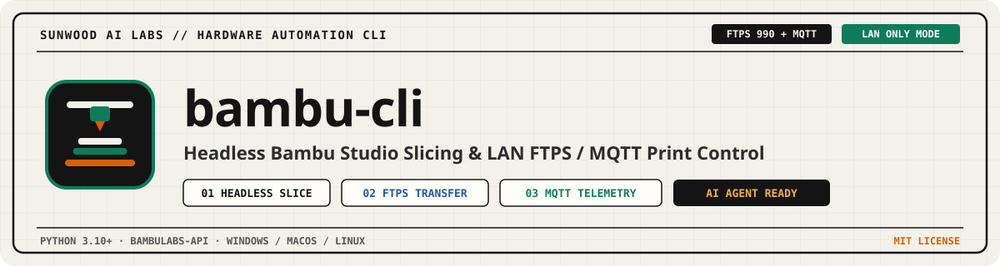
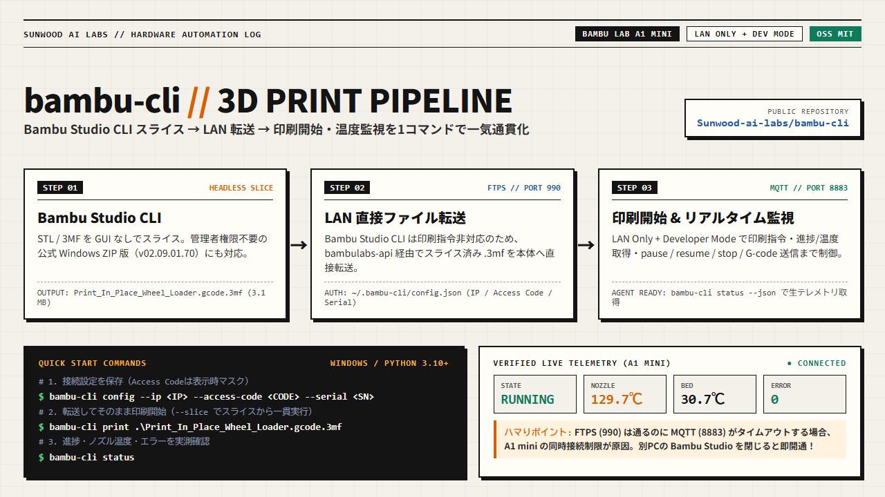

<div align="center">
  

  <h1>bambu-cli</h1>
  <p><strong>Bambu Studio CLI（ヘッドレススライス）＆ LAN 経由 FTPS / MQTT 印刷制御を一気通貫化する CLI ツール</strong></p>

  <p>
    <a href="https://github.com/Sunwood-ai-labs/bambu-cli/actions/workflows/ci.yml"></a>
    <a href="https://github.com/Sunwood-ai-labs/bambu-cli/actions/workflows/docs.yml"></a>
    <a href="https://github.com/Sunwood-ai-labs/bambu-cli/blob/main/LICENSE"></a>
    
    
  </p>

  <p>
    <strong>🌐 言語:</strong>
    <a href="./README.md">English</a> |
    <a href="./README.ja.md"><strong>日本語</strong></a>
    &nbsp;&nbsp;·&nbsp;&nbsp;
    <strong>📚 ドキュメント:</strong>
    <a href="https://sunwood-ai-labs.github.io/bambu-cli/ja/">ドキュメントサイト</a>
  </p>
</div>

---

## ✨ 概要

**`bambu-cli`** は、**Bambu Studio CLI**（ヘッドレススライス）と **`bambulabs-api`**（LAN 経由の FTPS ファイル転送・MQTT 印刷制御）を 1 つの CLI ワークフローにまとめたツールです。

Bambu Studio 本体の CLI はスライス専用でネットワーク印刷指令には対応していません。`bambu-cli` はそのギャップを埋め、ターミナルや AI エージェントから `.stl`/`.3mf` のスライス → FTPS (`990`) 転送 → MQTT (`8883`) 印刷開始 → 温度・進捗の取得 → 一時停止/中止までを一気通貫で実行できるようにします。

> **Bambu Lab A1 mini**（Windows / Bambu Studio `v02.09.01.70` / LAN Only Mode + Developer Mode）で実機検証済み。

<div align="center">
  
</div>

---

## 🚀 主な特徴

- **⚡ スライス〜印刷開始を 1 コマンド化**: `.stl` / `.3mf` / `.gcode.3mf` を受け取り、必要ならヘッドレススライス → FTPS (`990`) 転送 → MQTT (`8883`) で印刷開始。
- **📊 実測テレメトリ & エージェント向け JSON 出力**: `bambu-cli status` で状態 (`RUNNING` 等)・レイヤー・進捗・残り時間・ノズル/ベッド/チャンバー温度・Wi-Fi 強度を取得（`--json` で生 MQTT ダンプ対応）。
- **🎛️ 印刷制御 & G-code 送信**: `pause` / `resume` / `stop` / `light on|off` / 任意 `gcode` 送信に対応。
- **🔒 認証情報のローカル分離**: IP・Access Code・Serial は `~/.bambu-cli/config.json` に保存（表示時は Access Code をマスク）。環境変数 `BAMBU_IP` / `BAMBU_ACCESS_CODE` / `BAMBU_SERIAL` でも上書き可能。

---

## 📦 インストール

```bash
git clone https://github.com/Sunwood-ai-labs/bambu-cli.git
cd bambu-cli
uv pip install -e .
# または: pip install -e .
```

ヘッドレススライスを使う場合は [Bambu Studio](https://github.com/bambulab/BambuStudio/releases) が必要です。Windows で管理者権限（UAC）を使わず導入したい場合は、公式 Windows ZIP 版を展開して `bambu-cli config --bambu-studio <bambu-studio.exeのパス>` で登録できます。

---

## 🔧 事前準備（プリンター本体側）

プリンター本体のタッチパネルから以下を有効化してください：

1. **LAN Only Mode** を ON
2. **Developer Mode** を ON（※最新ファームウェアでサードパーティ CLI から MQTT 印刷指令を送るために必要）
3. 表示される **IPアドレス**・**アクセスコード（Access Code）**・**シリアル番号（Serial Number）** を控える

---

## ⚡ クイックスタート

### 1. 接続設定を保存

```powershell
bambu-cli config --ip 192.168.1.50 --access-code 12345678 --serial 01P00A000000000
```

### 2. 接続・テレメトリ確認

```powershell
bambu-cli status
```

### 3. 転送＆印刷開始

```powershell
# スライス済み .gcode.3mf を転送して印刷開始
bambu-cli print .\model.gcode.3mf

# AMS を使わず外部スプールで印刷
bambu-cli print .\model.gcode.3mf --no-ams

# STL を Bambu Studio CLI でスライスしてからそのまま印刷
bambu-cli print .\model.stl --settings "machine.json;process.json" --filaments "filament.json"
```

---

## 🛠️ コマンド一覧

| コマンド | 説明 |
| :--- | :--- |
| `bambu-cli config` | 接続情報・デフォルト設定の保存と確認 |
| `bambu-cli status [--json]` | 状態・進捗・レイヤー・温度・Wi-Fi 強度の取得 |
| `bambu-cli slice <file>` | Bambu Studio CLI でのヘッドレススライス |
| `bambu-cli upload <file>` | FTPS (`990`) で `.gcode.3mf` をプリンターへ転送 |
| `bambu-cli print <file>` | 必要に応じたスライス + FTPS 転送 + MQTT 印刷開始 |
| `bambu-cli pause \| resume \| stop` | 進行中の印刷を一時停止 / 再開 / 中止 |
| `bambu-cli light on \| off` | チャンバーライトの ON / OFF |
| `bambu-cli gcode "<cmd>"` | 任意の G-code コマンド送信（例: `"G28"`） |

---

## ⚠️ トラブルシューティング

### FTPS (`990`) は繋がるのに、MQTT (`8883`) がタイムアウトする
Bambu Lab A1 mini の MQTT (`8883`) は**同時接続できるクライアント数が非常に少ない**仕様です。別の PC などで Bambu Studio がプリンターに繋ぎっぱなしになっていると、CLI 側の `status` や `print` がタイムアウトします。

- **対処法**: 別 PC の Bambu Studio を一度閉じてから再実行してください（解消しない場合はプリンター本体を再起動）。

---

## 📄 ライセンス

MIT License — 詳細は [LICENSE](./LICENSE) を参照してください。
