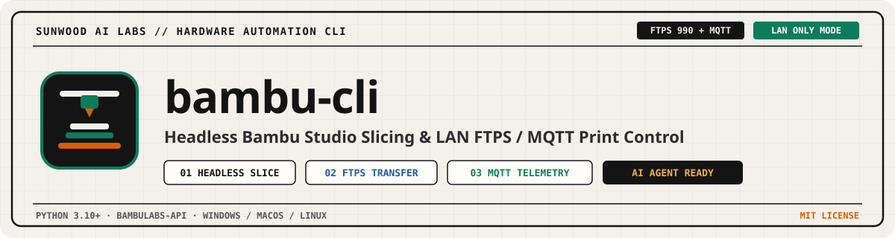
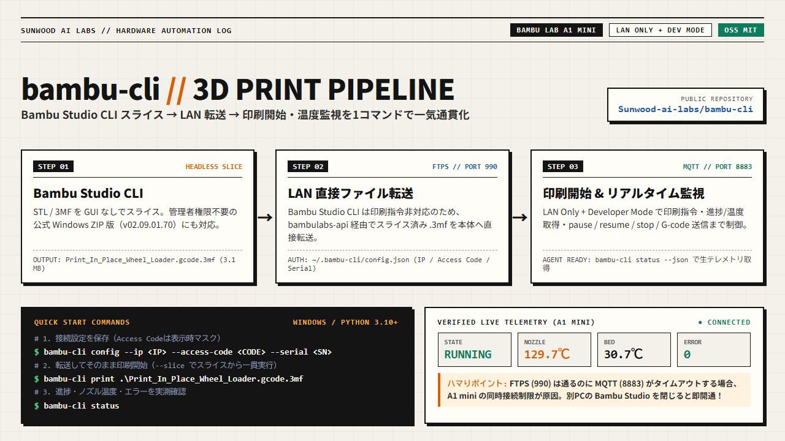

<div align="center">
  

  <h1>bambu-cli</h1>
  <p><strong>Headless Bambu Studio Slicing &amp; LAN FTPS / MQTT Print Control CLI for Bambu Lab 3D Printers</strong></p>

  <p>
    <a href="https://github.com/Sunwood-ai-labs/bambu-cli/actions/workflows/ci.yml"></a>
    <a href="https://github.com/Sunwood-ai-labs/bambu-cli/actions/workflows/docs.yml"></a>
    <a href="https://github.com/Sunwood-ai-labs/bambu-cli/blob/main/LICENSE"></a>
    
    
  </p>

  <p>
    <strong>🌐 Language:</strong>
    <a href="./README.md"><strong>English</strong></a> |
    <a href="./README.ja.md">日本語</a>
    &nbsp;&nbsp;·&nbsp;&nbsp;
    <strong>📚 Docs:</strong>
    <a href="https://sunwood-ai-labs.github.io/bambu-cli/">Documentation Site</a>
  </p>
</div>

---

## ✨ Overview

**`bambu-cli`** combines **Bambu Studio CLI** (headless slicing) with **`bambulabs-api`** (LAN FTPS file transfer & MQTT printer control) into one unified command-line workflow.

Bambu Studio's built-in CLI only handles slicing and does not send network print commands. `bambu-cli` bridges that gap so developers, scripts, and AI agents can slice `.stl`/`.3mf` models, upload `.gcode.3mf` over FTPS (`990`), trigger prints over MQTT (`8883`), inspect live temperatures/progress, and pause/stop jobs directly from the terminal.

> Verified on **Bambu Lab A1 mini** (Windows, Bambu Studio `v02.09.01.70`, LAN Only Mode + Developer Mode).

<div align="center">
  
</div>

---

## 🚀 Key Features

- **⚡ End-to-End Slice-to-Print**: Pass `.stl`, `.3mf`, or `.gcode.3mf` to `bambu-cli print` — slices headlessly when needed, uploads over FTPS (`990`), and starts printing over MQTT (`8883`).
- **📊 Live Telemetry & Agent-Ready JSON**: `bambu-cli status` reports state (`RUNNING`, etc.), layer progress, remaining time, nozzle/bed/chamber temperatures, and Wi-Fi RSSI (`--json` dumps raw MQTT payload).
- **🎛️ Full Print & Hardware Control**: `pause`, `resume`, `stop`, `light on|off`, and raw `gcode` commands.
- **🔒 Local Credential Isolation**: Stores printer IP, Access Code, and Serial in `~/.bambu-cli/config.json` (masks Access Code when printed) with `BAMBU_IP` / `BAMBU_ACCESS_CODE` / `BAMBU_SERIAL` env overrides.

---

## 📦 Installation

```bash
git clone https://github.com/Sunwood-ai-labs/bambu-cli.git
cd bambu-cli
uv pip install -e .
# or: pip install -e .
```

For headless slicing, install [Bambu Studio](https://github.com/bambulab/BambuStudio/releases). On Windows without UAC admin elevation, you can extract the official Windows ZIP release and register it via `bambu-cli config --bambu-studio <path-to-bambu-studio.exe>`.

---

## 🔧 Printer Prerequisites

On your Bambu Lab printer's touchscreen:

1. Enable **LAN Only Mode**.
2. Enable **Developer Mode** (required on recent firmware to accept third-party MQTT print commands).
3. Note your **IP Address**, **Access Code**, and **Serial Number**.

---

## ⚡ Quick Start

### 1. Save Connection Config

```powershell
bambu-cli config --ip 192.168.1.50 --access-code 12345678 --serial 01P00A000000000
```

### 2. Verify Live Telemetry

```powershell
bambu-cli status
```

### 3. Upload & Start Printing

```powershell
# Upload sliced .gcode.3mf and start printing
bambu-cli print .\model.gcode.3mf

# Print using external spool (without AMS)
bambu-cli print .\model.gcode.3mf --no-ams

# Slice an .stl with Bambu Studio CLI and print immediately
bambu-cli print .\model.stl --settings "machine.json;process.json" --filaments "filament.json"
```

---

## 🛠️ Command Reference

| Command | Description |
| :--- | :--- |
| `bambu-cli config` | Save or inspect connection config and default paths/settings |
| `bambu-cli status [--json]` | Inspect live state, layer, progress, temperatures, and Wi-Fi |
| `bambu-cli slice <file>` | Headless slice via Bambu Studio CLI |
| `bambu-cli upload <file>` | Upload `.gcode.3mf` to the printer via FTPS (`990`) |
| `bambu-cli print <file>` | Optional slice + FTPS upload + MQTT print start |
| `bambu-cli pause \| resume \| stop` | Control the active print job |
| `bambu-cli light on \| off` | Toggle the printer chamber light |
| `bambu-cli gcode "<cmd>"` | Send a raw G-code command (e.g., `"G28"`) |

---

## ⚠️ Troubleshooting

### FTPS (`990`) works, but MQTT (`8883`) times out
Bambu Lab A1 mini allows only a very small number of simultaneous MQTT (`8883`) client connections. If another PC or Bambu Studio instance is connected to the printer, CLI commands (`status`, `print`, `pause`) may time out.

- **Fix**: Close Bambu Studio on other machines connected to the same printer and retry (or power-cycle the printer if a stale socket persists).

---

## 📄 License

MIT License — see [LICENSE](./LICENSE).
